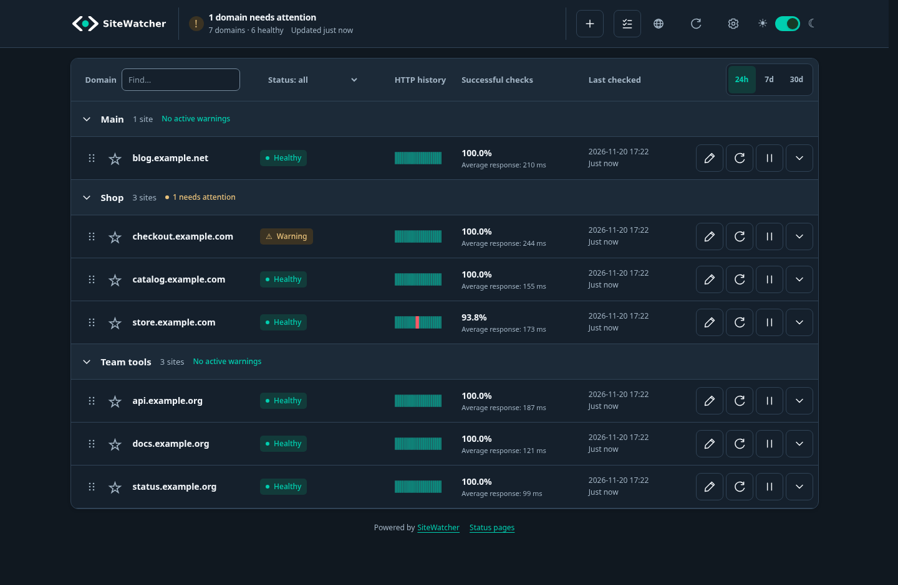
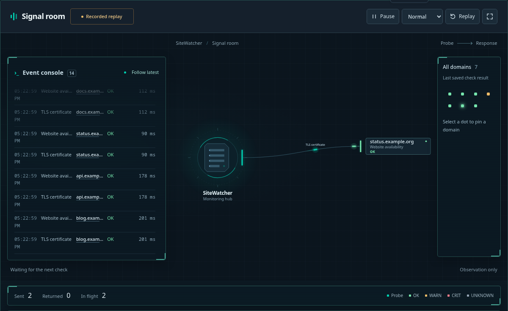
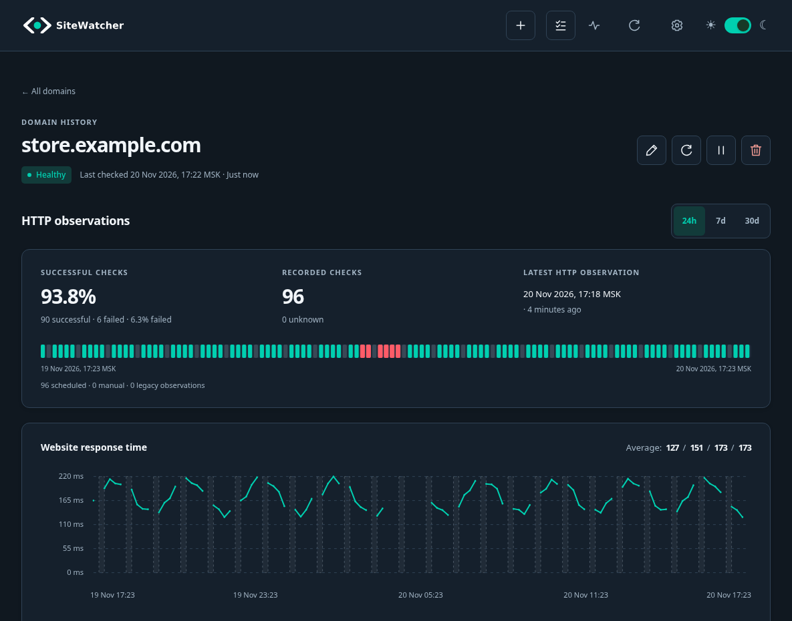

<h1 align="center">
  <picture>
    <source media="(prefers-color-scheme: dark)" srcset="assets/brand/logo-dark.svg">
    
  </picture>
</h1>

<p align="center"><strong>Checks your websites and lets you know when something goes wrong.</strong></p>
<p align="center"><strong><a href="https://monitoring.kurkov.dev/demo">Open the live demo</a></strong></p>
<p align="center"><a href="README.ru.md">Русский</a> · <strong>English</strong></p>

[](docs/screenshots/readme-overview-dark-en.png)

<table>
  <tr>
    <td width="50%"><a href="docs/screenshots/readme-signals-dark-en.png"></a></td>
    <td width="50%"><a href="docs/screenshots/readme-history-dark-en.png"></a></td>
  </tr>
  <tr>
    <td align="center">Signal room</td>
    <td align="center">Response times and checks</td>
  </tr>
</table>

The demo is a public status page. You can see the monitored sites and open the Signal room without signing in. The screenshots above show the signed-in workspace with sample data.

## What can I monitor?

- Whether a site opens, what HTTP status it returns, and how long the request takes.
- When its HTTPS certificate and domain registration expire.
- Whether a page still contains the words you expect, or shows signs of defacement.
- Changes to its IP addresses, blocklist and reputation reports, TCP ports, and the route to the server.

Choose the checks and alert channels for each site. Group sites in the dashboard, look back through their check history, and share selected sites or groups on public or private status pages. Alerts can go to email, Telegram, or both.

Some checks use external data. VirusTotal needs an API key, and its reports are cached for 24 hours. The [user guide](docs/usage.en.md) explains how to set up each check and read its results.

## Get started

Install Git and Docker with Compose, then run:

```bash
git clone --depth 1 https://github.com/NikKurkov/sitewatcher.git
cd sitewatcher
docker compose run --rm --build setup
docker compose up -d
```

The `setup` command asks for a username and password. Once both commands finish, open **http://127.0.0.1:8080**, sign in and click **Add domain** (the **+** icon at the top).

Basic checks work straight away. You can connect Telegram and other services later. The dashboard is local by default. Leave the computer or server running so checks can continue.

## Next steps

The **[user guide](docs/usage.en.md)** covers installation without Docker, adding websites, understanding results, Telegram, proxies, extra checks, public status pages, updates and backups.

[Changelog](CHANGELOG.md) · [Report a problem](https://github.com/NikKurkov/sitewatcher/issues) · [MIT license](LICENSE)
