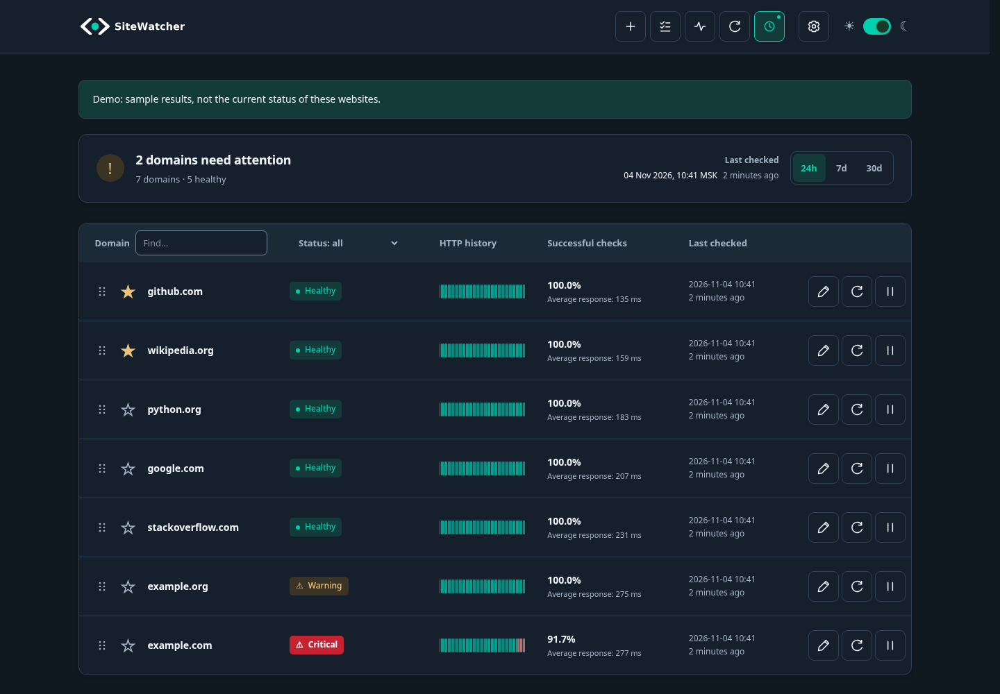
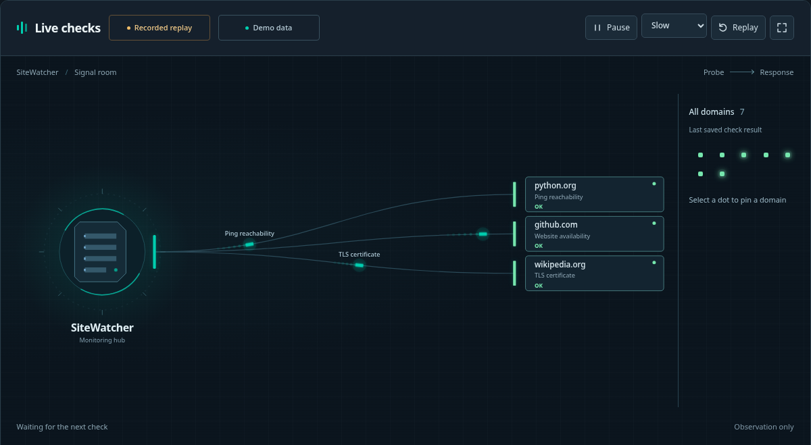
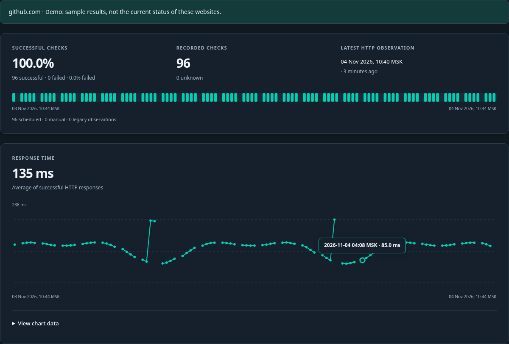

<h1 align="center">
  <picture>
    <source media="(prefers-color-scheme: dark)" srcset="assets/brand/logo-dark.svg">
    
  </picture>
</h1>

<p align="center"><strong>Checks your websites and lets you know when something goes wrong.</strong></p>
<p align="center"><a href="README.ru.md">Русский</a> · <strong>English</strong></p>

[](docs/screenshots/readme-overview-dark-en.png)

<table>
  <tr>
    <td width="50%"><a href="docs/screenshots/readme-signals-dark-en.png"></a></td>
    <td width="50%"><a href="docs/screenshots/readme-history-dark-en.png"></a></td>
  </tr>
  <tr>
    <td align="center">Watch checks in progress</td>
    <td align="center">History and response times</td>
  </tr>
</table>

## What is it for?

Keep an eye on an online shop, a company website or your own projects. SiteWatcher brings them together on one screen so you can see whether they open, how quickly they respond and whether anything needs attention.

It helps you:

- Notice when a website stops responding or becomes slow.
- See when a domain or HTTPS certificate needs renewing.
- Look through past checks to find when a problem started.
- Get Telegram messages about problems and recovery.
- Share a status page for the websites you choose.

## What does it check?

Available checks:

- **Availability and speed** — whether the page opens, its response code and response time.
- **HTTPS certificate and domain registration** — when they expire.
- **Page content** — required words and signs of website defacement.
- **Website reputation** — threat reports from VirusTotal; an API key is required. Each owner/domain report, including provider failures, is cached in the database for 24 hours. Manual checks and shorter schedules cannot bypass this limit. A missing report may require both a lookup and URL submission; the next lookup takes place after a day.
- **IP addresses** — address changes and IP blocklist checks through DroneBL,
  Blocklist.de and PSBL by default. Each source must pass positive and negative
  control queries. At least one completed clean source is enough for OK; missing
  sources are noted as incomplete coverage. If none completes, the result is unknown.
  Access errors never become false listings. Override sources with `ipbl.zones` in YAML.
- **Network** — connection latency, TCP port availability and the route to the server.

Choose which checks to run for each website. See the [user guide](docs/usage.en.md) for details.

## How does it work?

1. **Add a website address**, such as `example.com` or `example.com/catalog/`.
2. **SiteWatcher checks it on a schedule** and saves the results.
3. **Open the dashboard or receive an alert** if you have connected Telegram.

The map shows checks moving between SiteWatcher and your websites. Open a site's history for the details.

SiteWatcher runs on your computer or server. That machine must stay on for checks to continue.

## Get started

You need Git and a running [Docker](https://docs.docker.com/get-started/get-docker/) installation with Compose. Open a terminal and run:

```bash
mkdir sitewatcher &&
cd sitewatcher &&
git clone https://github.com/NikKurkov/sitewatcher.git . &&
docker compose run --rm --build setup &&
docker compose up -d
```

The `setup` command asks you to choose a username and password. Then open **http://127.0.0.1:8080**, sign in and click **Add domain** — the **+** icon at the top.

Basic checks work straight away. You can connect Telegram and other services later. By default, the dashboard is accessible only on the computer running it.

## Next steps

The **[user guide](docs/usage.en.md)** covers installation without Docker, adding websites, understanding results, Telegram, proxies, extra checks, public status pages, updates and backups.

[Report a problem](https://github.com/NikKurkov/sitewatcher/issues) · [MIT license](LICENSE)
