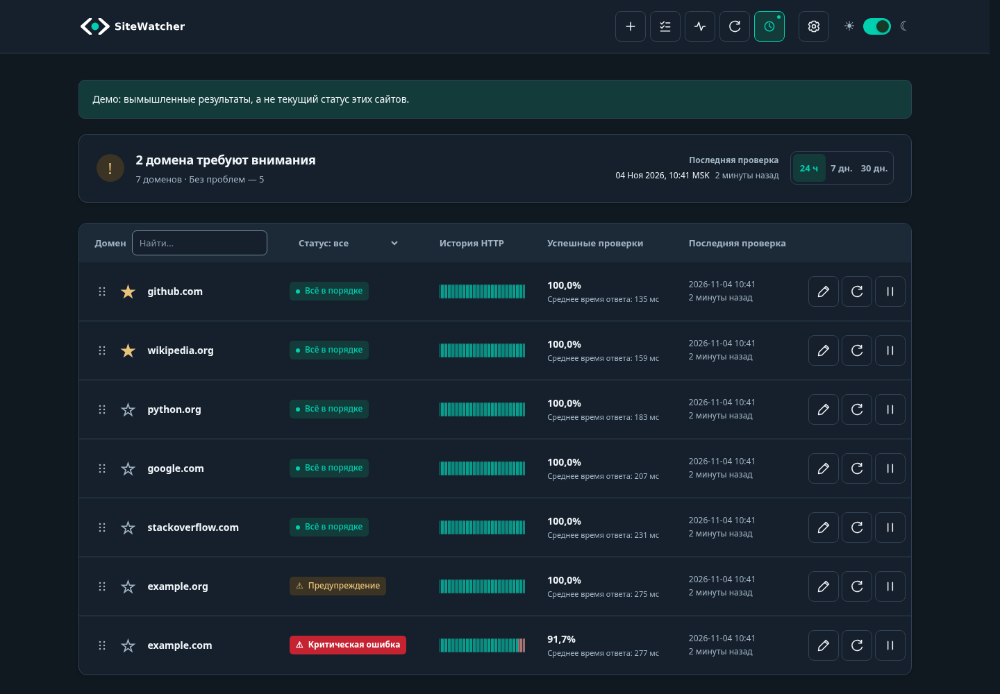
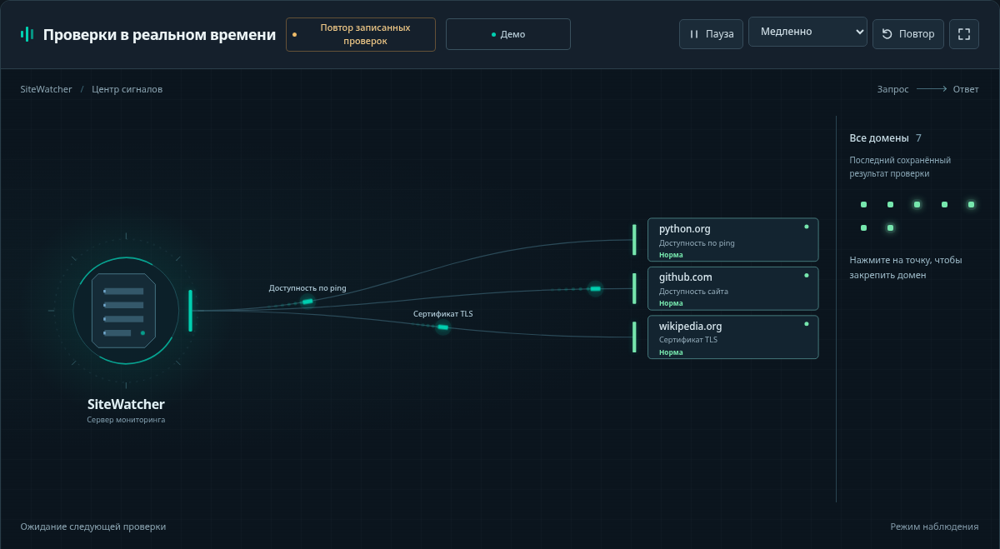
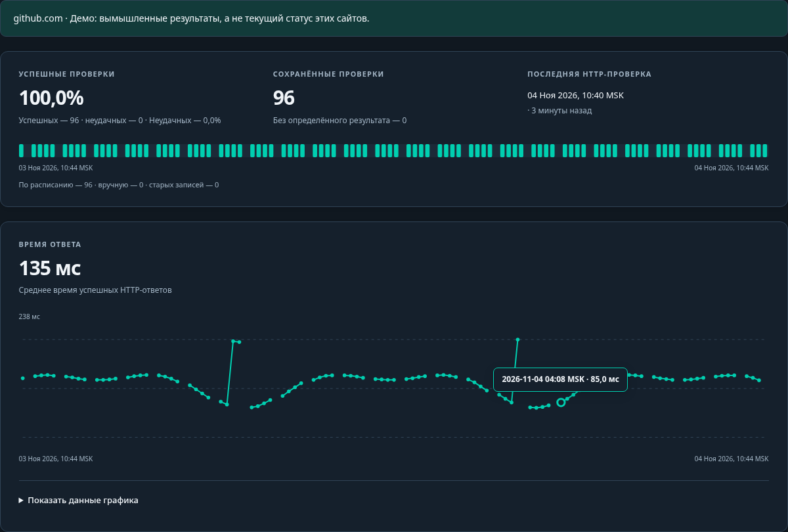

<h1 align="center">
  <picture>
    <source media="(prefers-color-scheme: dark)" srcset="assets/brand/logo-dark.svg">
    
  </picture>
</h1>

<p align="center"><strong>Проверяет ваши сайты и сообщает, если что-то пошло не так.</strong></p>
<p align="center"><strong>Русский</strong> · <a href="README.md">English</a></p>

[](docs/screenshots/readme-overview-dark-ru.png)

<table>
  <tr>
    <td width="50%"><a href="docs/screenshots/readme-signals-dark-ru.png"></a></td>
    <td width="50%"><a href="docs/screenshots/readme-history-dark-ru.png"></a></td>
  </tr>
  <tr>
    <td align="center">Как проходят проверки</td>
    <td align="center">История и время ответа</td>
  </tr>
</table>

## Для чего это нужно

Чтобы держать под присмотром интернет-магазин, сайт компании или свои проекты. SiteWatcher собирает их состояние на одном экране: открывается ли сайт, быстро ли отвечает и нет ли других проблем.

Программа помогает:

- Заметить, что сайт перестал открываться или стал медленным.
- Узнать, когда пора продлить домен или сертификат для HTTPS.
- Посмотреть историю и понять, когда появилась проблема.
- Получать сообщения о сбоях и восстановлении в Telegram.
- Дать клиентам ссылку на страницу состояния выбранных сайтов.

## Что проверяет

**Блокировки Роскомнадзора (РКН)** — отдельно по имени домена и его IP-адресу. Домен или его родительский домен в списке блокировок — критическая ошибка. IP в списке — предупреждение: на общем хостинге блокировка может относиться к другому сайту. Используются базы Antifilter и резервный источник bol-van; результат показывает наличие в этих списках, а не доступность у каждого провайдера.

Также доступны:

- **Доступность и скорость** — открывается ли страница, какой код ответа возвращает и сколько времени отвечает.
- **Сертификат HTTPS и регистрация домена** — когда истекает срок действия.
- **Содержимое страницы** — есть ли нужные слова и признаки подмены сайта.
- **Репутация сайта** — сведения об угрозах из VirusTotal; нужен API-ключ. Отчёт для каждого домена кешируется в базе на 24 часа, включая ошибки провайдера. Ручная проверка и частое расписание этот срок не обходят. Если отчёта ещё нет, одна проверка может включать чтение и отправку URL на анализ; результат запрашивается повторно через сутки.
- **IP-адреса** — изменился ли адрес сайта и есть ли он в настроенных чёрных списках.
- **Сеть** — задержка соединения, доступность TCP-портов и маршрут до сервера.

Набор проверок можно настроить для каждого сайта. Подробности — в [руководстве пользователя](docs/usage.ru.md).

## Как это работает

1. **Вы добавляете адрес сайта**, например `example.com` или `example.com/catalog/`.
2. **SiteWatcher проверяет его по расписанию** и сохраняет результаты.
3. **Вы смотрите панель или получаете уведомление**, если подключили Telegram.

На карте можно наблюдать за ходом проверок. Для подробностей откройте историю сайта.

SiteWatcher работает на вашем компьютере или сервере. Чтобы проверки продолжались, он должен оставаться включённым.

## Как запустить

Нужны Git и запущенный [Docker](https://docs.docker.com/get-started/get-docker/) с Compose. Откройте терминал и выполните:

```bash
mkdir sitewatcher &&
cd sitewatcher &&
git clone https://github.com/NikKurkov/sitewatcher.git . &&
docker compose run --rm --build setup &&
docker compose up -d
```

Команда `setup` попросит придумать логин и пароль. Затем откройте **http://127.0.0.1:8080**, войдите и нажмите **«Добавить домен»** — значок **+** вверху.

Базовые проверки работают сразу. Telegram и дополнительные сервисы можно подключить позже. По умолчанию панель доступна только на компьютере, где вы её запустили.

## Что дальше

В **[руководстве пользователя](docs/usage.ru.md)** собраны пошаговые инструкции: запуск без Docker, добавление сайтов, статусы, Telegram, прокси, дополнительные проверки, публичная страница, обновление и резервные копии.

[Сообщить об ошибке](https://github.com/NikKurkov/sitewatcher/issues) · [Лицензия MIT](LICENSE)
