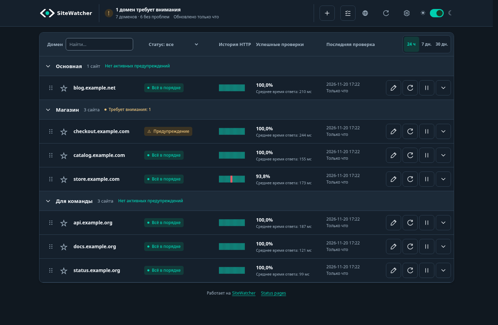
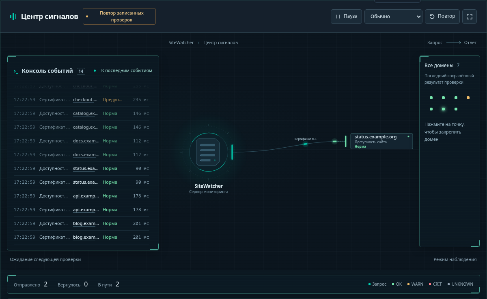
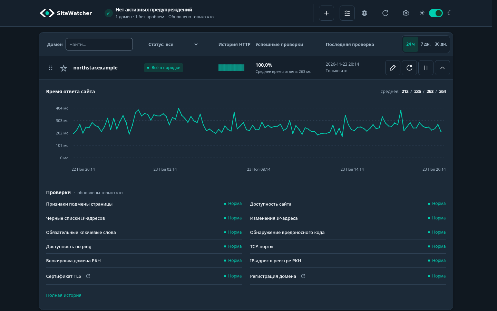

<h1 align="center">
  <picture>
    <source media="(prefers-color-scheme: dark)" srcset="assets/brand/logo-dark.svg">
    
  </picture>
</h1>

<p align="center"><strong>Проверяет ваши сайты и сообщает, если что-то пошло не так.</strong></p>
<p align="center"><strong><a href="https://monitoring.kurkov.dev/demo">Открыть демо</a></strong></p>
<p align="center"><strong>Русский</strong> · <a href="README.md">English</a></p>

[](docs/screenshots/readme-overview-dark-ru.png)

<table>
  <tr>
    <td width="50%"><a href="docs/screenshots/readme-signals-dark-ru.png"></a></td>
    <td width="50%"><a href="docs/screenshots/readme-history-dark-ru.png"></a></td>
  </tr>
  <tr>
    <td align="center">Центр сигналов</td>
    <td align="center">История и время ответа</td>
  </tr>
</table>

В демо открывается публичная страница состояния. Посмотреть список сайтов и открыть Центр сигналов можно без входа. На скриншотах выше показана панель владельца с демонстрационными данными.

## Что можно проверять

- Открывается ли сайт, какой код HTTP возвращает и сколько времени отвечает.
- Когда истекает срок действия сертификата HTTPS и регистрации домена.
- Остались ли на странице нужные слова и нет ли признаков подмены сайта.
- Не изменился ли IP-адрес, есть ли он в чёрных списках, доступны ли TCP-порты и как проходит маршрут до сервера.
- Есть ли домен или его IP в списках блокировок Роскомнадзора. Совпадение по IP может относиться к соседнему сайту на общем хостинге.

Для каждого сайта можно выбрать проверки и каналы уведомлений. Сайты можно объединять в группы, смотреть историю проверок и показывать выбранные сайты или группы на публичных или закрытых страницах состояния. Уведомления приходят по почте, в Telegram или сразу в оба канала.

Для некоторых проверок нужны внешние данные. Для VirusTotal понадобится API-ключ, а отчёты сохраняются в кеше на 24 часа. Настройка и расшифровка результатов есть в [руководстве пользователя](docs/usage.ru.md).

## Как запустить

Установите Git и Docker с Compose, затем выполните:

```bash
git clone https://github.com/NikKurkov/sitewatcher.git
cd sitewatcher
docker compose run --rm --build setup
docker compose up -d
```

Команда `setup` попросит придумать логин и пароль. Когда обе команды завершатся, откройте **http://127.0.0.1:8080**, войдите и нажмите **«Добавить домен»** (значок **+** вверху).

Базовые проверки работают сразу. Telegram и дополнительные сервисы можно подключить позже. По умолчанию панель открывается только на той машине, где запущен SiteWatcher. Чтобы проверки продолжались, оставьте её включённой.

## Что дальше

В **[руководстве пользователя](docs/usage.ru.md)** описано, как запустить SiteWatcher без Docker, добавлять сайты, читать результаты, настраивать Telegram, прокси, дополнительные проверки и страницы состояния, обновляться и делать резервные копии.

[История изменений](CHANGELOG.md) · [Сообщить об ошибке](https://github.com/NikKurkov/sitewatcher/issues) · [Лицензия MIT](LICENSE)
